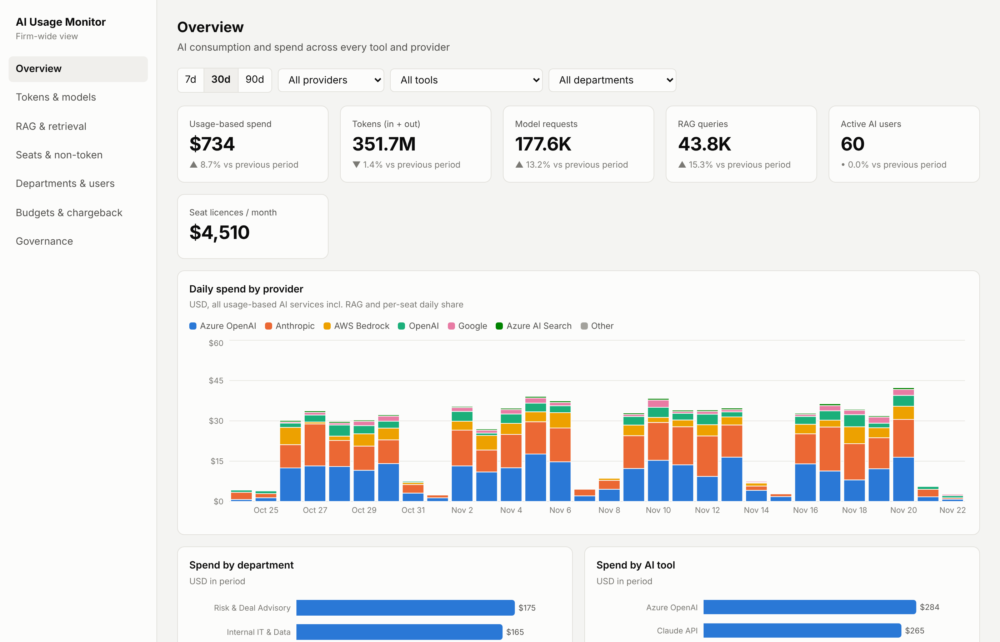

# AI Usage Monitor

A central platform that shows **who in the firm uses which AI tools, how much, and what it costs**:
LLM tokens, RAG (vector search, retrieved documents, embeddings), non-token usage (images, audio
minutes, API calls, code suggestions) and seat licences, broken down by department, team, user,
engagement/project and application. Built for a professional-services firm's controls environment:
SSO with role-based access, row-level scoping, a tamper-evident audit trail, pseudonymisation and
no storage of prompt or response content.



**Stack:** Python 3.12 · FastAPI · PostgreSQL 16 + TimescaleDB · React 18 + TypeScript + Recharts (Vite) · Docker Compose.

---

## Contents

1. [How it works](#1-how-it-works)
2. [What to install](#2-what-to-install)
3. [Folder structure](#3-folder-structure)
4. [Step-by-step: run it locally (15 minutes)](#4-step-by-step-run-it-locally)
5. [Step-by-step: connect your real AI tools](#5-step-by-step-connect-your-real-ai-tools)
6. [Step-by-step: instrument internal apps and RAG pipelines](#6-step-by-step-instrument-internal-apps-and-rag-pipelines)
7. [Data model](#7-data-model)
8. [API reference](#8-api-reference)
9. [Security, privacy and compliance](#9-security-privacy-and-compliance)
10. [Going to production](#10-going-to-production)
11. [Delivery roadmap](#11-delivery-roadmap)

---

## 1. How it works

AI usage reaches the platform through three channels, chosen per tool:

| Channel | Use it for | How |
|---|---|---|
| **Pull collectors** | Vendor-hosted tools with admin/billing APIs | `worker` service polls every hour: OpenAI, Anthropic (API + Claude Code), Azure OpenAI, AWS Bedrock, Gemini/Vertex, GitHub Copilot, Microsoft 365 Copilot |
| **Push SDK / AI gateway** | Your own apps, agents and RAG pipelines | Apps call the `aiusage` Python SDK or route via a LiteLLM / Azure APIM gateway that posts to `POST /api/ingest/events` |
| **CSV upload** | Tools with no API (invoices, ChatGPT Enterprise exports, niche SaaS) | `POST /api/ingest/csv` |

All three feed one pipeline: **normalise, enrich from the HR directory (dept/team), pseudonymise
(optional), price, de-duplicate, then store** in a single TimescaleDB fact table. The dashboard
reads it through an analytics API that applies role-based row scoping to every query.

```
 OpenAI ─┐  Anthropic ─┐  Azure OpenAI ─┐  Bedrock ─┐  Gemini ─┐  Copilot seats ─┐
         └──────────── worker (collectors, hourly) ──────────────────────────────┘
                                         │ upsert
 Internal apps ── aiusage SDK ──┐        ▼
 LiteLLM / APIM gateway ────────┼─► FastAPI  /api/ingest ──► pipeline ──► PostgreSQL + TimescaleDB
 CSV exports ───────────────────┘        │                                   │
                                          └── /api/analytics (RBAC) ◄────────┘
                                                     │
                                     React dashboard · chargeback CSV · Power BI
```

Detail: [docs/ARCHITECTURE.md](docs/ARCHITECTURE.md).

## 2. What to install

**To run locally (pick one path):**

| Path | Install |
|---|---|
| A. Docker (recommended) | [Docker Desktop](https://www.docker.com/products/docker-desktop/) 4.30+ (or Docker Engine + Compose v2) · Git |
| B. Without Docker | Python 3.12+ · Node.js 20 or 22 LTS · PostgreSQL 16 (TimescaleDB 2.17 optional) · Git |

**Python packages** (`backend/requirements.txt`): fastapi, uvicorn, SQLAlchemy 2, psycopg 3,
pydantic 2, PyJWT, httpx, APScheduler, plus optional cloud SDKs per collector: boto3 (Bedrock),
azure-identity + azure-monitor-query (Azure OpenAI), google-cloud-bigquery (Gemini).

**Node packages** (`frontend/package.json`): react, react-dom, recharts, vite, typescript.

**Recommended developer tools:** VS Code (Python, Pylance, ESLint extensions), `psql` or DBeaver,
Postman/Bruno for the API, Azure CLI / AWS CLI / gcloud for the cloud collectors.

**Accounts and permissions you will need** (one per tool you want to monitor; detail in section 5):
OpenAI org *Admin key*, Anthropic *Admin API key*, Azure *Monitoring Reader* on the Azure OpenAI
resources, AWS IAM role with `cloudwatch:GetMetricData`, GCP billing export to BigQuery, GitHub
token with *Copilot Business: read*, Entra ID app with *Reports.Read.All*, and an Entra ID app
registration for SSO.

## 3. Folder structure

```
ai-usage-monitor/
├── README.md                     ← this guide
├── docker-compose.yml            ← db (TimescaleDB) + api + worker + web
├── .env.example                  ← every setting; copy to .env
├── backend/
│   ├── Dockerfile
│   ├── requirements.txt
│   ├── app/
│   │   ├── main.py               ← FastAPI app, security headers, CORS
│   │   ├── config.py             ← settings (env vars)
│   │   ├── db.py                 ← engine, session, TimescaleDB hypertable set-up
│   │   ├── models.py             ← database schema (single source of truth)
│   │   ├── schemas.py            ← request validation (blocks prompt content)
│   │   ├── auth.py               ← OIDC / dev JWT, roles, permissions, row scoping
│   │   ├── seed.py               ← reference data + 90 days of demo usage
│   │   ├── worker.py             ← scheduler: collectors + retention
│   │   ├── routers/
│   │   │   ├── ingest.py         ← POST /api/ingest/events, /csv
│   │   │   ├── analytics.py      ← dashboard queries, budgets, chargeback export
│   │   │   ├── admin.py          ← tools, prices, licences, budgets, keys, audit
│   │   │   └── auth_routes.py
│   │   ├── services/
│   │   │   ├── ingest.py         ← normalise → enrich → pseudonymise → price → dedupe
│   │   │   ├── pricing.py        ← price catalogue lookup
│   │   │   └── audit.py          ← hash-chained audit log + verification
│   │   └── collectors/
│   │       ├── base.py, registry.py
│   │       ├── openai_collector.py, anthropic_collector.py
│   │       ├── azure_openai_collector.py, bedrock_collector.py, gemini_collector.py
│   │       └── copilot_collectors.py   ← GitHub Copilot + Microsoft 365 Copilot
│   ├── migrations/               ← 001_schema.sql (Timescale policies), 002_security.sql (DB roles)
│   └── tests/test_api.py         ← end-to-end API tests (RBAC, dedupe, pricing, audit)
├── frontend/
│   ├── Dockerfile, nginx.conf    ← static build behind nginx with CSP
│   └── src/
│       ├── App.tsx               ← layout, navigation, role-gated pages, dev sign-in
│       ├── lib/                  ← API client, formatting, colour palette
│       ├── components/           ← charts, filters, cards
│       └── pages/                ← Overview, Tokens, RAG, Seats & non-token, People, Budgets, Governance
├── sdk/python/aiusage/           ← client SDK + LangChain callback
├── integrations/
│   ├── litellm_callback.py       ← AI-gateway pattern (recommended)
│   └── rag_pipeline_example.py   ← instrumented RAG pipeline
└── docs/
    ├── ARCHITECTURE.md
    ├── COLLECTORS.md             ← per-vendor set-up and permissions
    ├── SECURITY.md               ← controls, privacy, DPIA inputs
    └── DEPLOYMENT.md             ← Azure / AWS production reference
```

## 4. Step-by-step: run it locally

### Path A: Docker

```bash
# 1. Get the code into a folder and enter it
cd ai-usage-monitor

# 2. Create your settings file (defaults work for a local demo)
cp .env.example .env

# 3. Build and start database, API, worker and web UI
docker compose up -d --build

# 4a. EITHER load demo data (90 days of fake usage, demo users, licences, budgets) to explore
docker compose exec api python -m app.seed

# 4b. OR start clean for real use: tool catalogue + prices + one admin, nothing fake.
#     Also removes any demo rows already loaded. Safe to re-run.
docker compose exec -e ADMIN_EMAIL=you@company.com api python -m app.seed --clean

# 5. Open the dashboard
#    UI:       http://localhost:3000
#    API docs: http://localhost:8000/api/docs
```

Sign in with a demo persona to see role-based views: **Avery Admin** (everything), **Fin
Controller** (finance), **Ira Auditor** (read-only + audit log), **Tara Taxlead** (Tax department
only), or an employee (own usage only).

Run the tests: `docker compose exec api pytest -q`

### Path B: without Docker

```bash
# 1. Database
createdb aiusage            # PostgreSQL 16; TimescaleDB is used automatically if installed

# 2. Backend
cd backend
python -m venv .venv && source .venv/bin/activate      # Windows: .venv\Scripts\activate
pip install -r requirements.txt
export DATABASE_URL="postgresql+psycopg://<user>:<password>@localhost:5432/aiusage"
python -m app.seed
uvicorn app.main:app --reload --port 8000

# 3. Worker (second terminal, only once you configure collectors)
python -m app.worker

# 4. Frontend (third terminal)
cd frontend
npm install
npm run dev                 # http://localhost:5173 (proxies /api to :8000)
```

No PostgreSQL handy? For a quick look, `export DATABASE_URL=sqlite:///./demo.db` works for the
API and dashboard. Use PostgreSQL for anything real.

### Send your first event

```bash
curl -X POST http://localhost:8000/api/ingest/events \
  -H "X-API-Key: aiu_demo_local_only_key_change_me" -H "Content-Type: application/json" \
  -d '{"source":"sdk","events":[{"tool_id":"azure-openai","provider":"azure_openai","model":"gpt-4o",
       "user_id":"tax.lead@firm.example","input_tokens":1200,"output_tokens":300,"project":"ENG-1001"}]}'
```

The event is priced from the price catalogue and attributed to the user's department.

### How data reaches the dashboard (and how fresh it is)

| Source | How it arrives | Typical delay until it shows |
|---|---|---|
| Your apps via SDK / LiteLLM gateway | App POSTs to `/api/ingest/events` (SDK flushes every 5 s) | under ~1 minute |
| Vendor collectors (Anthropic, OpenAI, Azure, Bedrock, Gemini, Copilot) | `worker` calls each vendor's admin API every `COLLECTOR_INTERVAL_MINUTES` (default 60) and re-reads recent days | vendor lag + up to one interval. Anthropic's analytics data refreshes within ~4 h (up to 24 h) |
| CSV upload | Manual | immediate |

The dashboard re-queries the API every 60 seconds (and on **Refresh**), so anything stored in the
database appears without reloading the page. It is near-real-time, not streaming: vendor admin APIs
themselves are delayed, so per-call real-time numbers only come from the SDK / gateway path.

If a collector fails, the **Governance → Data collectors** panel shows the vendor's error message,
and the worker retries after 5, 15 and 30 minutes before returning to the normal interval.

## 5. Step-by-step: connect your real AI tools

1. **Build your AI inventory.** List every AI tool in use (IT procurement, expense reports, SSO app
   catalogue, firewall/CASB logs for shadow AI). Register each in *Governance* or with
   `PUT /api/admin/tools/{id}`, with owner and data classification.
2. **Load your directory.** Connect Workday (`WORKDAY_REPORT_URL` + ISU), Entra ID
   (`ENTRA_DIRECTORY_SYNC=true`) or upload a CSV from any HR system on *Governance → People
   directory*. This fills departments, teams, cost centres and people, and back-fills the department
   on usage that arrived earlier. Give department heads the `dept_manager` role there. Each person's
   other identities (GitHub login, vendor user ids) go in their aliases.
   Step by step: [docs/INTEGRATIONS.md](docs/INTEGRATIONS.md).
3. **Load your negotiated prices** into the price catalogue (`POST /api/admin/prices`). The demo
   ships with illustrative list prices only. Model patterns ending in `*` match model families.
4. **Enter seat licences** on the *Seats & non-token* page (Add licence) or with `POST /api/admin/licenses`: SKU, seats purchased, price, renewal date.
5. **Enable collectors** by filling the matching keys in `.env`, then `docker compose restart worker`:

   | Tool | Setting(s) | Permission needed |
   |---|---|---|
   | OpenAI API | `OPENAI_ADMIN_KEY` | Organisation admin key |
   | Anthropic API + Claude Code | `ANTHROPIC_ADMIN_KEY` | **Admin** API key (`sk-ant-admin...`, Console → Settings → Admin keys); a normal `sk-ant-api...` key returns 401 |
   | Azure OpenAI / AI Foundry | `AZURE_OPENAI_RESOURCE_IDS` | Monitoring Reader (managed identity) |
   | AWS Bedrock | `BEDROCK_ENABLED=true`, `AWS_REGION` | `cloudwatch:ListMetrics`, `GetMetricData` |
   | Gemini / Vertex AI | `GCP_BILLING_TABLE` | BigQuery Data Viewer + Job User on billing export |
   | GitHub Copilot | `GITHUB_ORG`, `GITHUB_TOKEN` | Copilot Business: read (org) |
   | Microsoft 365 Copilot | `MS_GRAPH_TENANT_ID`, `MS_GRAPH_CLIENT_ID`, `MS_GRAPH_CLIENT_SECRET` | Graph `Reports.Read.All` (application) |

   Full per-vendor instructions, including how to get **per-user** attribution where the vendor
   only reports per key or deployment: [docs/COLLECTORS.md](docs/COLLECTORS.md).
6. **Trigger a first run** from the API (`POST /api/admin/collectors/{name}/run`) and check
   `GET /api/admin/collectors` for status. Collectors re-read the last 3 days every run and
   *replace* those buckets, so late-arriving vendor data is corrected automatically.
7. **Reconcile** the first month against vendor invoices before publishing chargeback figures.
8. **Set budgets** per department, tool or engagement (`POST /api/admin/budgets`).

## 6. Step-by-step: instrument internal apps and RAG pipelines

Vendor APIs can't see *your* RAG pipelines or which employee triggered a call through a shared
service account. Two ways to close that gap:

**Option 1: AI gateway (recommended for scale).** Route all internal LLM traffic through a
LiteLLM proxy or Azure API Management. The gateway knows the caller, team, model, tokens and cost
of every call for every provider. Use [`integrations/litellm_callback.py`](integrations/litellm_callback.py),
or for APIM, the `llm-emit-token-metric` policy.

**Option 2: SDK in each app.**

```bash
pip install ./sdk/python          # add [langchain] for the callback
export AIUSAGE_URL=https://ai-usage.internal.firm  AIUSAGE_API_KEY=<ingest key>  AIUSAGE_APP="Tax Research Copilot"
```

```python
from aiusage import get_client
usage = get_client()

usage.track_llm(provider="azure_openai", model="gpt-4o", user_id=user_email,
                input_tokens=resp.usage.prompt_tokens, output_tokens=resp.usage.completion_tokens,
                project=engagement_code)

with usage.track_retrieval(vector_store="azure-ai-search", index_name="tax-guidance", user_id=user_email) as r:
    docs = search_client.search(...)
    r.documents_retrieved = len(docs)

usage.track_embedding(provider="azure_openai", model="text-embedding-3-large", input_tokens=n)
usage.track_image(provider="openai", model="gpt-image-1", images=2)
usage.track_audio(provider="azure_openai", model="whisper", minutes=42.5)
```

LangChain / LangGraph: `chain.invoke(x, config={"callbacks": [AIUsageCallback(user_id=..., vector_store="pgvector")]})`.

The SDK buffers in memory and flushes in a background thread, so it never blocks or breaks the
app. Create one ingest key per application (Governance page, or `POST /api/admin/ingest-keys`).
A runnable end-to-end example is in [`integrations/rag_pipeline_example.py`](integrations/rag_pipeline_example.py).

## 7. Data model

One fact table, `usage_events`, holds every kind of consumption; `event_type` and `unit_type` say
what the numbers mean.

| event_type | Key measures |
|---|---|
| `llm_call` | input / output / cached tokens, requests, latency |
| `embedding` | input tokens, documents embedded |
| `rag_retrieval`, `vector_query`, `rerank` | queries, `documents_retrieved`, `vector_store`, `index_name`, latency |
| `image`, `audio`, `api_call` | `quantity` + `unit_type` (image, audio_minute, code_suggestion…) |
| `seat` | one row per seat per day with the daily share of the licence price |

Every row carries **who** (user, team, department, project, application), **what** (tool,
provider, model), **cost** (`cost_usd`, with `cost_source` = provider / computed / none) and a
`dedupe_key`. Supporting tables: `departments`, `teams`, `users`, `ai_tools`, `price_catalog`,
`licenses`, `seat_assignments`, `budgets`, `ingest_keys`, `audit_log`, `collector_runs`.
Schema: [`backend/app/models.py`](backend/app/models.py); SQL with Timescale compression,
retention and a daily continuous aggregate: [`backend/migrations/001_schema.sql`](backend/migrations/001_schema.sql).

## 8. API reference

Interactive docs at `/api/docs` (disabled when `ENVIRONMENT=prod`).

| Method & path | Who | Purpose |
|---|---|---|
| `POST /api/ingest/events` | ingest key | Batch of up to 5,000 events |
| `POST /api/ingest/csv` | admin | Bulk CSV import |
| `GET /api/analytics/summary` | all roles (scoped) | KPIs + change vs previous period |
| `GET /api/analytics/timeseries?metric=&group_by=` | all roles (scoped) | Daily series |
| `GET /api/analytics/breakdown?dimension=&metric=` | all roles (scoped) | By provider, model, department, team, user, project, application… |
| `GET /api/analytics/rag` | all roles (scoped) | Vector stores, indexes, embeddings |
| `GET /api/analytics/rag/apps` | all roles (scoped) | Each RAG application: running/idle/inactive, queries, tokens, latency, spend |
| `GET /api/analytics/profile?dimension=&key=` | all roles (scoped) | Drill-down for one user, department, team, engagement or application |
| `GET/PUT /api/admin/users` | admin | People directory, roles, department fixes |
| `POST /api/admin/directory/import`, `/directory/reattribute` | admin | HR CSV upload; back-fill departments on past usage |
| `GET /api/analytics/non-token` | all roles (scoped) | Images, audio, API calls, searches |
| `GET /api/analytics/licenses`, `/inactive-seats` | admin, finance, auditor, dept manager | Seat utilisation, idle seats |
| `GET /api/analytics/budgets` | admin, finance, auditor, dept manager | Month-to-date vs budget + forecast |
| `GET /api/analytics/chargeback.csv` | admin, finance, auditor | Monthly chargeback by cost centre / project / tool |
| `GET/PUT/POST /api/admin/...` | admin (finance for budgets/licences) | Tools, prices, licences, budgets, ingest keys, collectors |
| `GET /api/admin/audit`, `/audit/verify` | admin, auditor | Audit trail and hash-chain verification |

Common filters on analytics: `start`, `end` (YYYY-MM-DD), `provider`, `tool_id`, `department_id`, `team_id`, `user_id`, `model`, `project`, `application`.

## 9. Security, privacy and compliance

Summary below; full control description and DPIA inputs in [docs/SECURITY.md](docs/SECURITY.md).

- **No content, only metering.** The ingest schema rejects `prompt`, `completion`, `messages` and
  similar keys. Client and engagement data never enters this system.
- **SSO + RBAC.** `AUTH_MODE=oidc` validates Entra ID / Okta tokens (issuer, audience, signature
  via JWKS). Five roles map to IdP app roles: admin, finance, auditor, dept_manager, viewer.
- **Row-level scoping** on every analytics query: managers see only their department, employees
  only themselves.
- **Pseudonymisation** (`PSEUDONYMIZE_USERS=true`): user ids become keyed HMAC pseudonyms; the key
  is held by Privacy/HR, not the platform team. Plus k-anonymity threshold `MIN_GROUP_SIZE`.
- **Tamper-evident audit log:** logins, exports, configuration changes and collector runs, each
  record hash-chained to the previous one; `GET /api/admin/audit/verify` proves integrity. Stream
  to your SIEM too.
- **Secrets:** vendor admin keys from Key Vault / Secrets Manager, never in source control. Ingest
  keys are stored only as SHA-256 hashes.
- **Data minimisation:** raw events kept 400 days (configurable), daily rollups longer for finance.
- **Hardening:** non-root containers, security headers + CSP, OpenAPI docs off in prod, start-up
  refuses `ENVIRONMENT=prod` with dev auth.

Before go-live, involve your **Data Protection Officer** (DPIA: employee monitoring is high-risk
processing in the EU/UK), **Works Council** where applicable, **InfoSec** (threat model, pen test)
and **Risk/Independence**: usage tagged with client engagement codes is itself confidential.

## 10. Going to production

See [docs/DEPLOYMENT.md](docs/DEPLOYMENT.md). In short:

1. Host on AKS/EKS or Azure Container Apps; managed PostgreSQL (Azure Database for PostgreSQL
   Flexible Server or Timescale Cloud / RDS) with private endpoints, encryption at rest, PITR backups.
2. Set `ENVIRONMENT=prod`, `AUTH_MODE=oidc`, OIDC issuer/audience/JWKS; register the SPA and API
   in Entra ID and define the five app roles; add MSAL to the frontend (`@azure/msal-react`).
3. Put the UI and API behind your WAF / Front Door; ingestion endpoint reachable only from the
   corporate network and gateway subnets.
4. Run `migrations/001_schema.sql` and `002_security.sql`; the API connects as the least-privilege role.
5. CI/CD: tests, SAST (Bandit, Semgrep), dependency and container scanning (Trivy), signed images.
6. Connect Power BI to the read-only role (or the `usage_daily` aggregate) for finance reporting.

## 11. Delivery roadmap

| Phase | Weeks | Outcome |
|---|---|---|
| 0. Discovery | 1–2 | AI inventory, stakeholders (CIO, CFO, DPO, Risk), DPIA started, roles agreed |
| 1. MVP | 3–6 | This starter deployed in a dev subscription; 2–3 collectors live; SSO; demo to sponsors |
| 2. Coverage | 7–10 | All vendor collectors; AI gateway for internal apps; SDK in top RAG apps; directory sync |
| 3. Finance | 11–14 | Negotiated price catalogue, reconciliation to invoices, budgets + alerts, chargeback into the GL |
| 4. Hardening | 15–18 | Pen test, DPIA sign-off, SIEM integration, DR test, go-live |
| 5. Optimise | ongoing | Idle-seat reclamation, model right-sizing, anomaly detection, forecasting |
